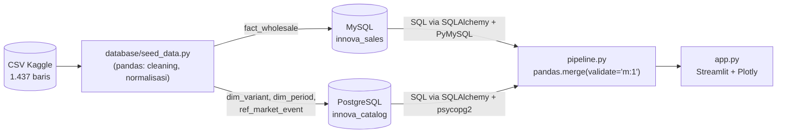

# 🚗 Dashboard Wholesale Toyota Kijang Innova (2017–2026)

Dashboard web interaktif berbasis **Python + Streamlit + Plotly** yang mengintegrasikan data dari
**dua DBMS berbeda (MySQL + PostgreSQL)** dengan penggabungan data (*federation*) di level aplikasi
menggunakan **pandas**.

Nama : Nabila Nur Rozak
NPM : 230660121059
Kelas : IF-VIIB

---

## 1. Skenario Bisnis

Data **wholesale** (distribusi dari pabrik ke dealer) Toyota Kijang Innova per bulan, per varian, periode
Januari 2017 – Maret 2026 (generasi **Reborn** dan **Zenix**). Pertanyaan yang dijawab dashboard:

1. Bagaimana tren wholesale bulanan/tahunan, dan kapan terjadi lonjakan atau penurunan?
2. Bagaimana pergeseran dari Reborn (bensin/diesel) ke Zenix (bensin/hybrid)?
3. Varian (tipe, transmisi, bahan bakar) mana yang paling dominan?
4. Adakah pola musiman antar bulan?

## 2. Arsitektur & Alur Pipeline



**Alur integrasi (`pipeline.py`):**

1. Extract — satu kueri ke MySQL (`fact_wholesale`) dan tiga kueri ke PostgreSQL (dimensi + event).
2. Join — `fact.merge(dim_variant, on="variant_id", validate="m:1")` lalu `.merge(dim_period, on="period_id", validate="m:1")`.
   `indicator=True` dipakai untuk menghitung baris tanpa pasangan.
3. Validasi — jumlah baris sebelum/sesudah join, baris tanpa pasangan (harus 0), dan total unit identik. Hasilnya tampil di tab Data & Pipeline.
4. Visualisasi — DataFrame terintegrasi difilter di sidebar lalu dirender oleh Plotly.


## 3. Fitur Interaktivitas

- Filter sidebar: rentang tahun, model, bahan bakar, transmisi, tipe, sub-tipe (semua grafik & KPI ikut berubah)
- KPI: total wholesale, YTD tahun terakhir vs tahun sebelumnya (periode bulan yang sama), bulan puncak, varian terlaris
- Tren bulanan dengan pilihan pemecahan (Model / Bahan bakar / Transmisi / Tipe / Powertrain) + anotasi peristiwa dari PostgreSQL (toggle)
- Bar bertumpuk per tahun, area porsi model, sunburst drill-down, top-N varian (slider), heatmap musiman
- Tab validasi pipeline, tab arsitektur (status koneksi kedua DBMS), unduh CSV hasil filter
- Hover/zoom/pan bawaan Plotly

## 4. Struktur Repositori

```
.
├── app.py                  # UI Streamlit
├── pipeline.py             # extract -> merge -> validasi (federasi pandas)
├── charts.py               # fungsi grafik Plotly
├── db.py                   # koneksi SQLAlchemy (kredensial dari env / secrets)
├── requirements.txt
├── data/Innova_Wholesales_Data_2017_2026.csv     # salinan data mentah Kaggle
├── database/
│   ├── mysql_schema.sql    # DDL MySQL
│   ├── postgres_schema.sql # DDL PostgreSQL
│   ├── seed_data.py        # CSV -> kedua DBMS (idempotent)
│   └── seed/market_events.csv
├── .env.example            # template kredensial (tanpa rahasia)
└── .streamlit/             # config.toml + secrets.toml.example
```

## 5. Menjalankan Secara Lokal

Lihat PANDUAN.md untuk langkah lengkap (XAMPP + Postgres.app). Ringkasnya:

```bash
python3 -m venv .venv && source .venv/bin/activate
pip install -r requirements.txt
cp .env.example .env            # isi kredensial
python database/seed_data.py    # membuat tabel + mengisi kedua database
streamlit run app.py
```

## 6. Deployment

Aplikasi di-deploy ke **Streamlit Community Cloud**. Karena server cloud tidak bisa mengakses `localhost`,
kedua database dihosting di cloud:

- PostgreSQL: `[ISI: Neon / Supabase / ...]`
- MySQL: `[ISI: TiDB Cloud Starter (MySQL-compatible) / ...]`

Kredensial disimpan di Secrets Streamlit (lihat `.streamlit/secrets.toml.example`); tidak ada password di kode maupun repositori.

## 7. Sumber Data

- Dataset primer: *Toyota Innova Wholesale Sales Indonesia 2017–2026* — Kaggle (yonathanhary)
  https://www.kaggle.com/datasets/yonathanhary/toyota-innova-wholesale-sales-indonesia2017-2026/data
- Lisensi dataset: `[ISI: cek kolom License di halaman Kaggle]`

### Catatan kualitas data (hasil pemeriksaan saat membuat seed)

- 1.437 baris, 2017-01 s.d. 2026-03 (2026 baru 3 bulan). Total 505.239 unit.
- Bulan ditulis `Sept` (bukan `Sep`) — dinormalisasi ke angka bulan.
- `Sub-Type` kosong di 873 baris → diisi `Tanpa Sub-Tipe`.
- Ada **27 baris dengan kombinasi kunci identik** (tahun, bulan, model, bahan bakar, transmisi, tipe, sub-tipe) tetapi angka berbeda
  — kemungkinan varian yang tidak dibedakan di dataset. Semua baris **dipertahankan** sebagai transaksi terpisah (`sale_id` unik,
  `source_row` menunjuk baris CSV) dan dijumlahkan saat agregasi.
- `ref_market_event` berisi anotasi sederhana: periode Apr–Jun 2020 (penurunan tajam di data) dan bulan pertama Zenix muncul di data (Nov 2022).
  Tambahkan `source_url` untuk sumber eksternal yang kamu verifikasi sendiri.
- Catatan engine: MySQL lokal pada XAMPP sebenarnya **MariaDB** (kompatibel MySQL). Di cloud dipakai `[ISI: engine MySQL-compatible yang kamu pakai]`.

## 8. Referensi Kode & Teknik

- Streamlit — Connect to MySQL: https://docs.streamlit.io/develop/tutorials/databases/mysql
- Streamlit — Connect to PostgreSQL: https://docs.streamlit.io/develop/tutorials/databases/postgresql
- SQLAlchemy 2.0: https://docs.sqlalchemy.org/en/20/
- pandas `DataFrame.merge`: https://pandas.pydata.org/docs/reference/api/pandas.DataFrame.merge.html
- Plotly Python (sunburst, heatmap, vrect): https://plotly.com/python/
- `[ISI: repositori GitHub publik lain yang benar-benar kamu pelajari/adaptasi, beserta bagian yang dipakai]`
